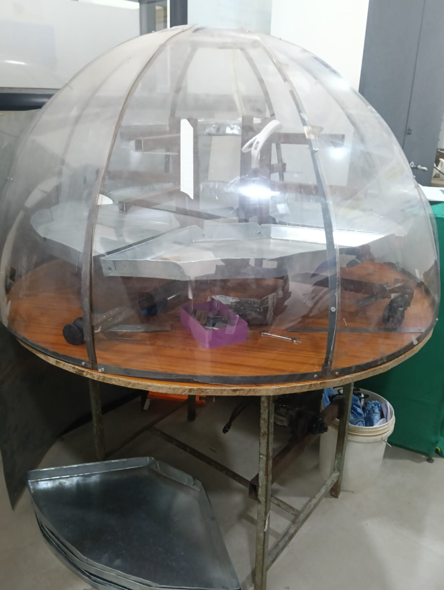
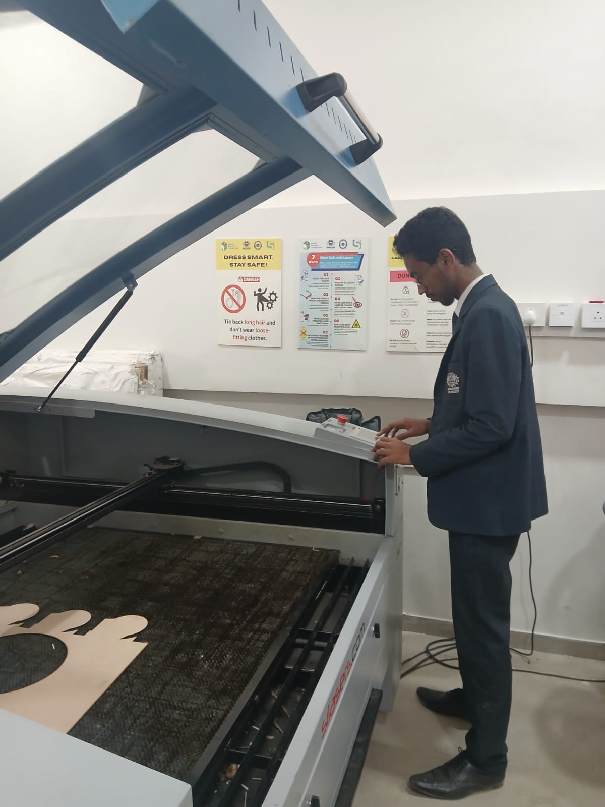
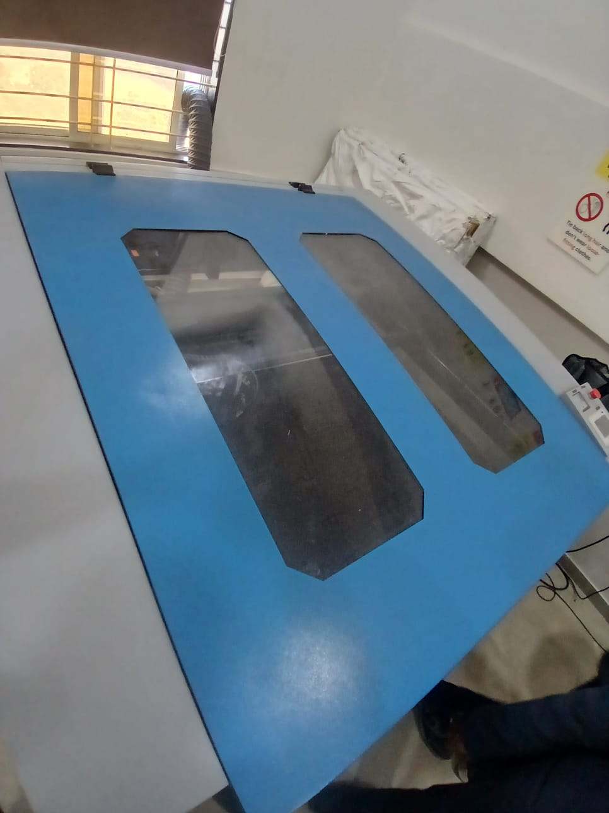
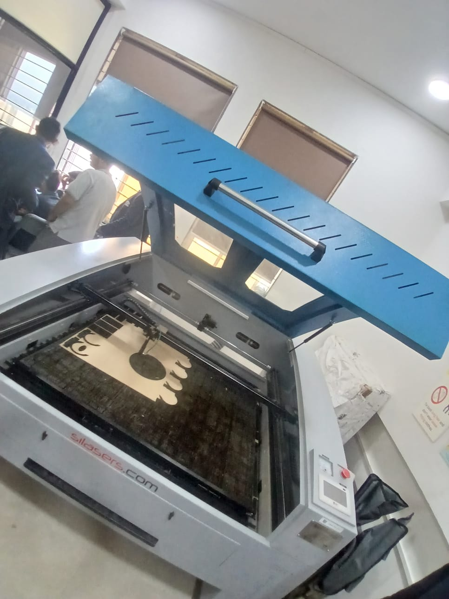

# Rotary Solar Dryer for Agricultural Products — Group 22

**Sanjivani University · Makerspace**

A low-cost, dome-covered solar dryer for farm produce. The produce sits on multi-tier galvanised trays inside a transparent dome, and a geared motor slowly turns the whole tray rack so that every tray gets an equal share of sunlight — no manual tray shuffling.

> **Status:** Prototype fabricated. Performance testing is next, so no drying results are claimed yet.

**Project website:** https://atharvgodase9252.github.io/Solar-Dryer-for-Agricultural-Products/

## How it works

1. **Trap the sun** — sunlight passes through the transparent dome and heats the produce and trays; the dome keeps the warm air in.
2. **Remove moisture** — the warm, drier air takes up water from the produce; moist air must be vented.
3. **Rotate for even drying** — a geared DC motor under the table drives the central shaft through a chain and sprockets. The shaft turns the cross-arm rack, whose casters roll on the tabletop and carry the load.
4. **Protect the produce** — the closed dome keeps out dust, insects, birds and rain.

## Laser cutting

Flat sheet parts were cut on the Makerspace SIL Lasers CO₂ laser cutter — see [docs/laser-cutting.md](docs/laser-cutting.md).

| Job set-up | Cutting | Finished part |
|---|---|---|
|  |  |  |

## Repository contents

| Folder / file | What it contains |
|---|---|
| `index.html`, `assets/` | Project website (GitHub Pages) |
| `cad/` | SolidWorks part files (`.SLDPRT`) |
| `media/photos/` | Workshop photographs |
| `media/cad/` | SolidWorks screenshots |
| `media/video/` | Workshop video |
| `docs/` | Engineering record (overview, principle, design, materials, fabrication, testing, safety, references) |

## CAD files

| File | Part |
|---|---|
| `cad/part-1-base.SLDPRT` | Base table — round top on a braced square-tube stand, centre hole for the shaft |
| `cad/part-2-rotating-rack.SLDPRT` | Rotating rack — cross base and tiered tray arms |
| `cad/inner-ring.SLDPRT` | Bearing inner ring |
| `cad/outer-ring.SLDPRT` | Bearing outer ring |
| `cad/ball.SLDPRT` | Bearing ball |
| `cad/tooth.SLDPRT` | Sprocket / gear tooth part |

Created in SOLIDWORKS 2026 (Academic). Open with SOLIDWORKS 2026 or newer.

## Documentation

- [Project overview](docs/project-overview.md)
- [Working principle](docs/working-principle.md)
- [Design and CAD](docs/design-and-cad.md)
- [Materials and components](docs/materials-and-components.md)
- [Fabrication and assembly](docs/fabrication-and-assembly.md)
- [Laser cutting](docs/laser-cutting.md)
- [Testing plan](docs/testing-plan.md)
- [Safety and maintenance](docs/safety-and-maintenance.md)
- [References](docs/references.md)

## Team

**Group 22** — Sanjivani University · Makerspace

| # | Name |
|---|---|
| 1 | Atharv Godase |
| 2 | Shubham Aher |
| 3 | Arush Pawase |
| 4 | Shubham Gavande |

**Project Guide:** Dr. Kiran Wakchaure
