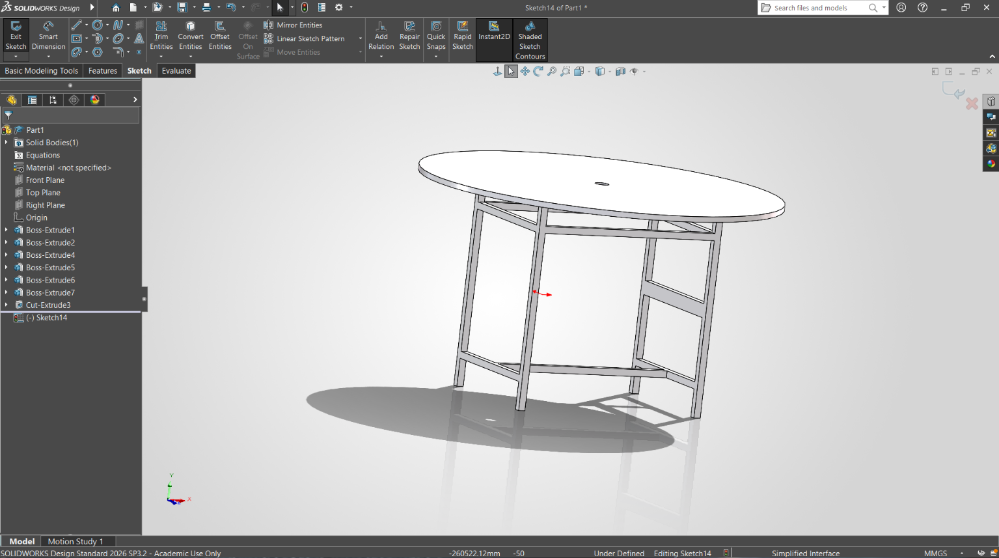

# Design and CAD

The dryer was modelled in SOLIDWORKS 2026 (Academic).

## Parts

| File | Description |
|---|---|
| `cad/part-1-base.SLDPRT` | Base table: round top on a braced mild-steel square-tube stand, centre hole for the shaft |
| `cad/part-2-rotating-rack.SLDPRT` | Rotating rack: cross base of square tubes, tiered tower arms with tray-locating plates |
| `cad/inner-ring.SLDPRT`, `cad/outer-ring.SLDPRT`, `cad/ball.SLDPRT` | Ball bearing parts for the shaft support |
| `cad/tooth.SLDPRT` | Sprocket / gear tooth part |

## Specification

| Item | Value |
|---|---|
| Dryer type | Direct (greenhouse-type) solar dryer with rotating rack |
| Cover | Transparent segmented dome with metal ribs |
| Base | Round tabletop on MS square-tube stand |
| Rack | MS square tube, cross base + tiered towers |
| Trays | GI sheet, sector-shaped, 4 per ring |
| Rack support | Swivel casters on the tabletop |
| Drive | Geared DC motor → sprockets → central shaft |
| Tabletop diameter | *to be added from drawing* |
| Dome height | *to be added* |
| Tray levels / total tray area | *to be added* |
| Rack speed | *to be measured* |
| Motor rating / power source | *to be added* |
