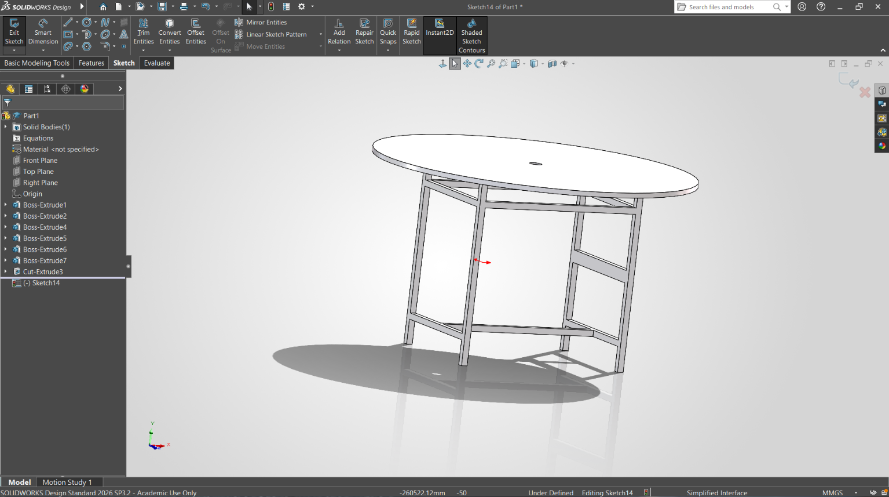
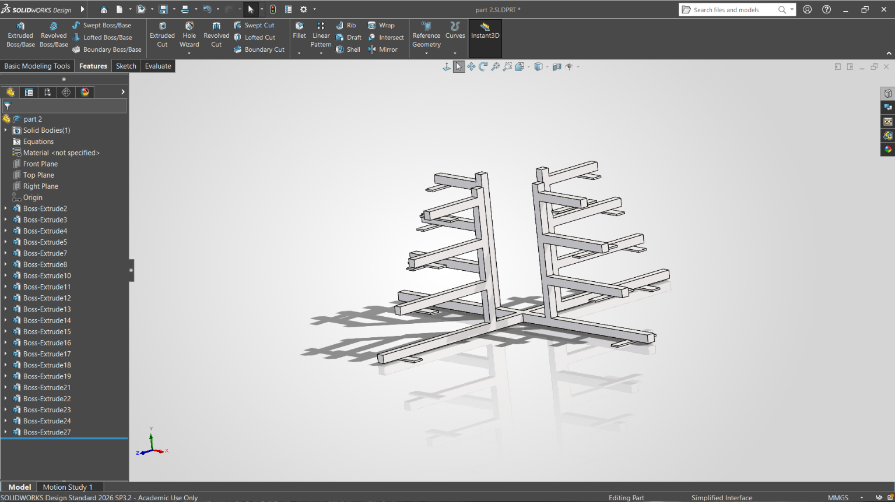
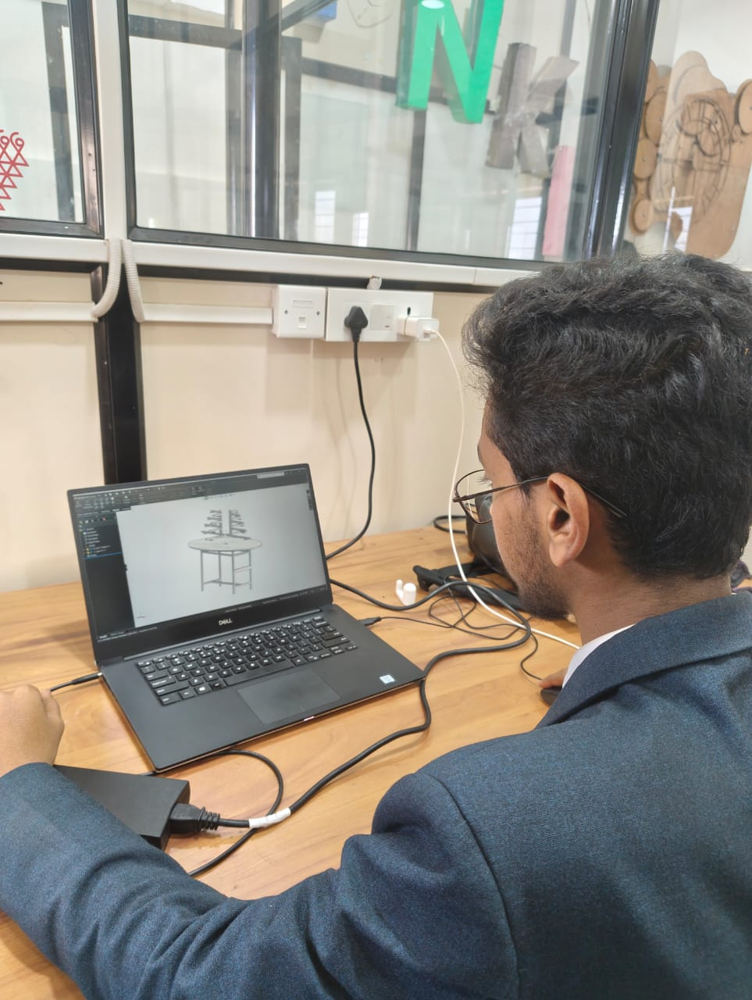
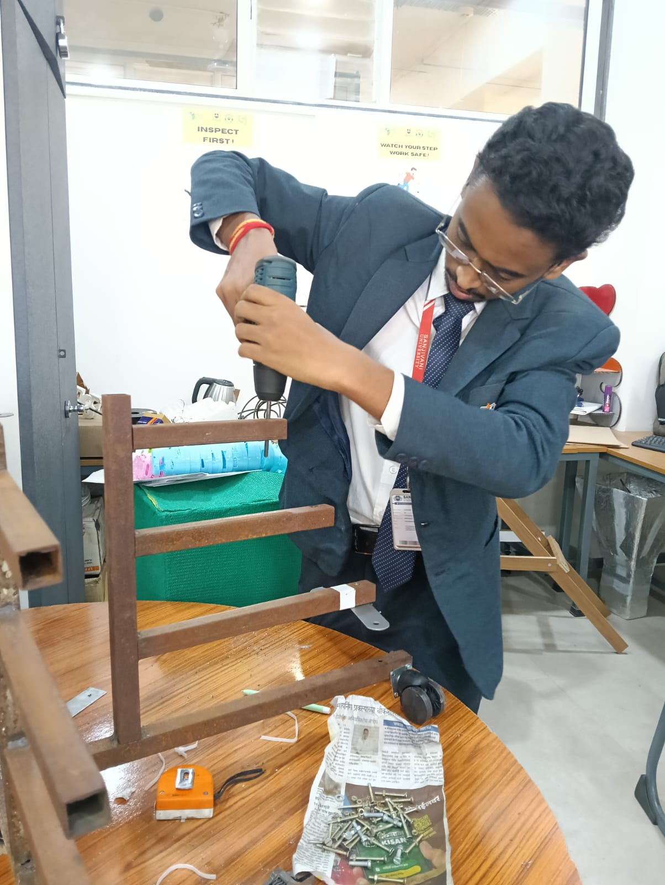
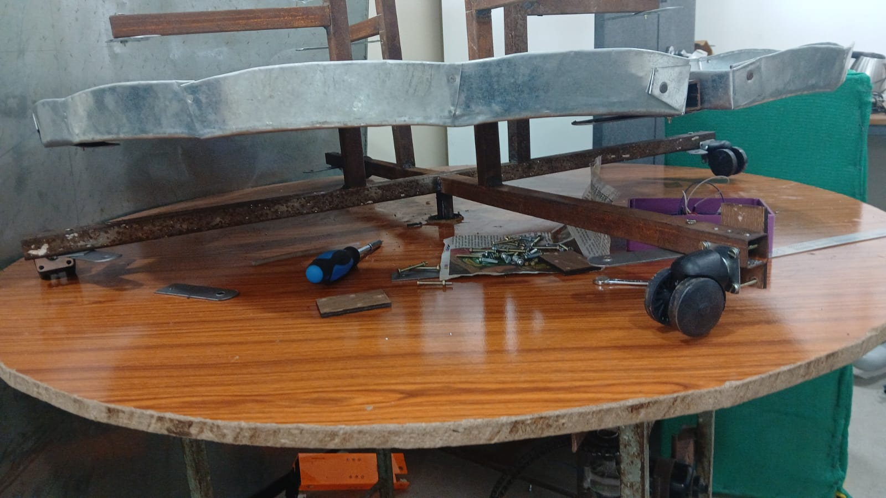
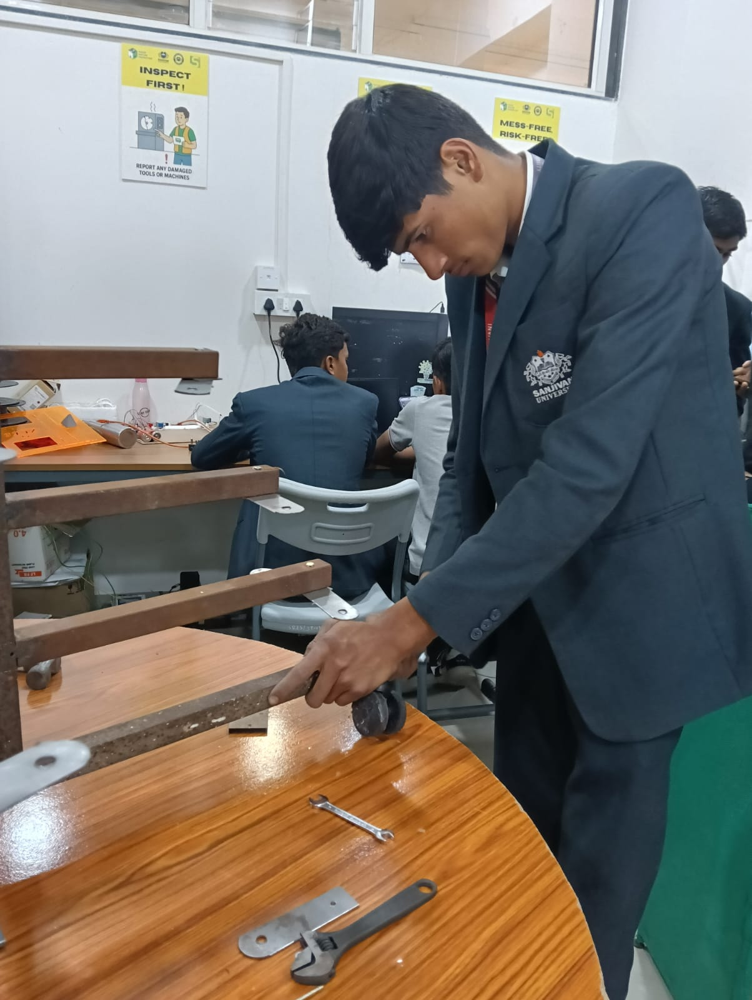
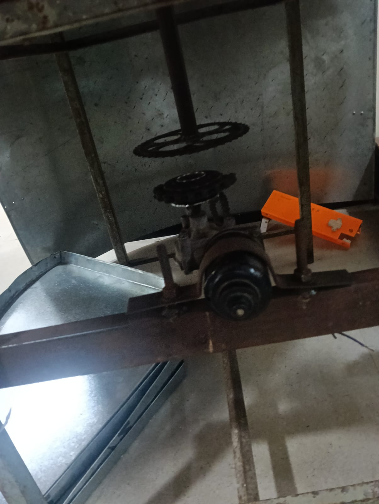
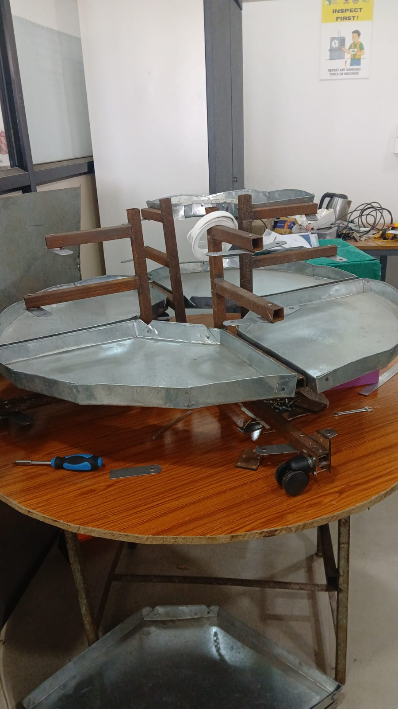
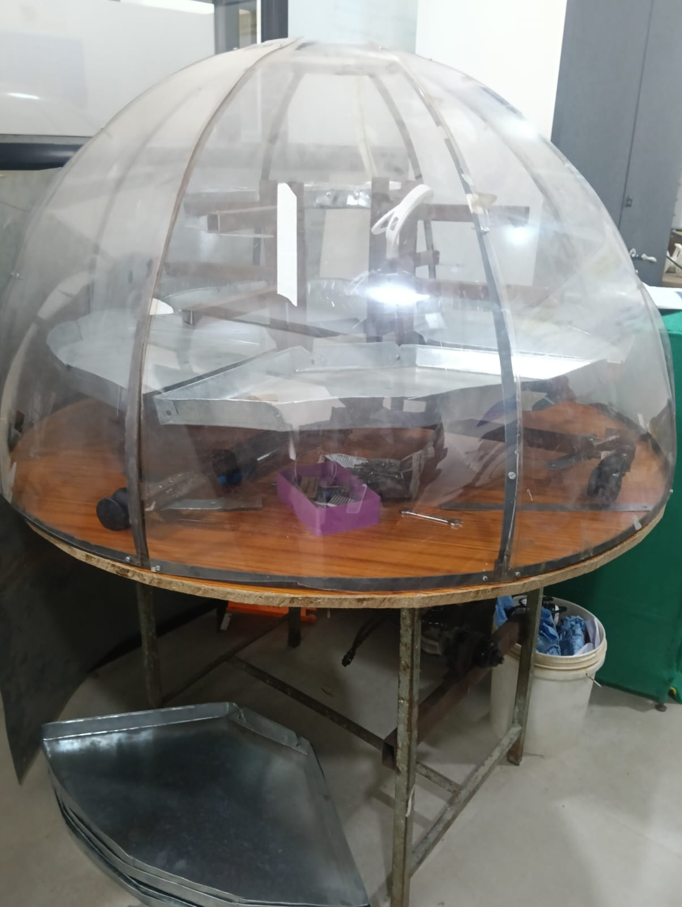

# Fabrication and assembly log

1. **CAD of base table** — round top on braced square-tube stand. 
2. **CAD of rotating rack** — cross base and tiered tray arms, then assembly with the base.  
3. **Rack fabrication and drilling** — MS square tube cut, welded and drilled for tray brackets and caster plates. 
4. **Casters fitted** to the ends of the cross arms.  
5. **Drive mechanism** — geared motor and sprockets mounted under the tabletop to turn the central shaft. 
6. **GI trays** cut and folded as sectors; trial-fitted on the rack. 
7. **Dome and final assembly** — transparent dome with ribs fixed to the tabletop edge. 
8. **Bracket drilling** on the bench drill — see `media/video/drilling-bracket.mp4`.

Dates were not recorded.
