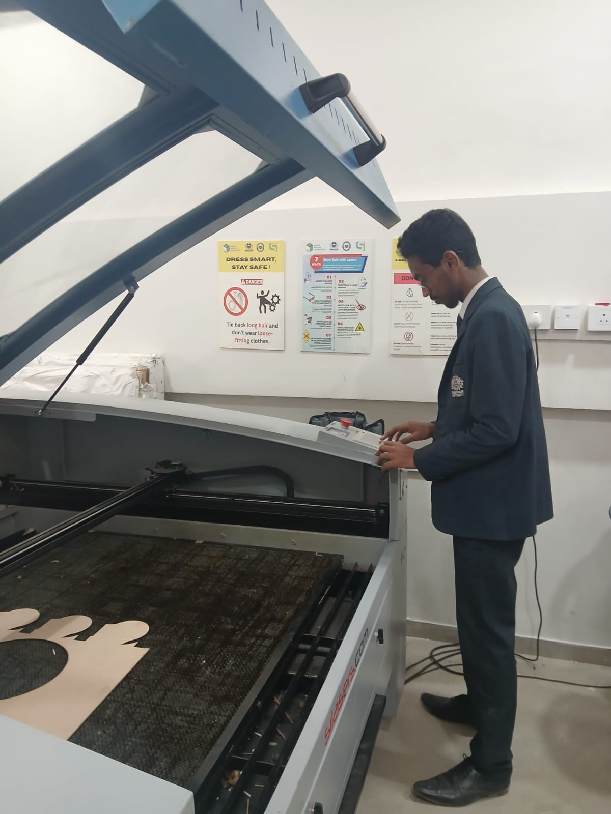
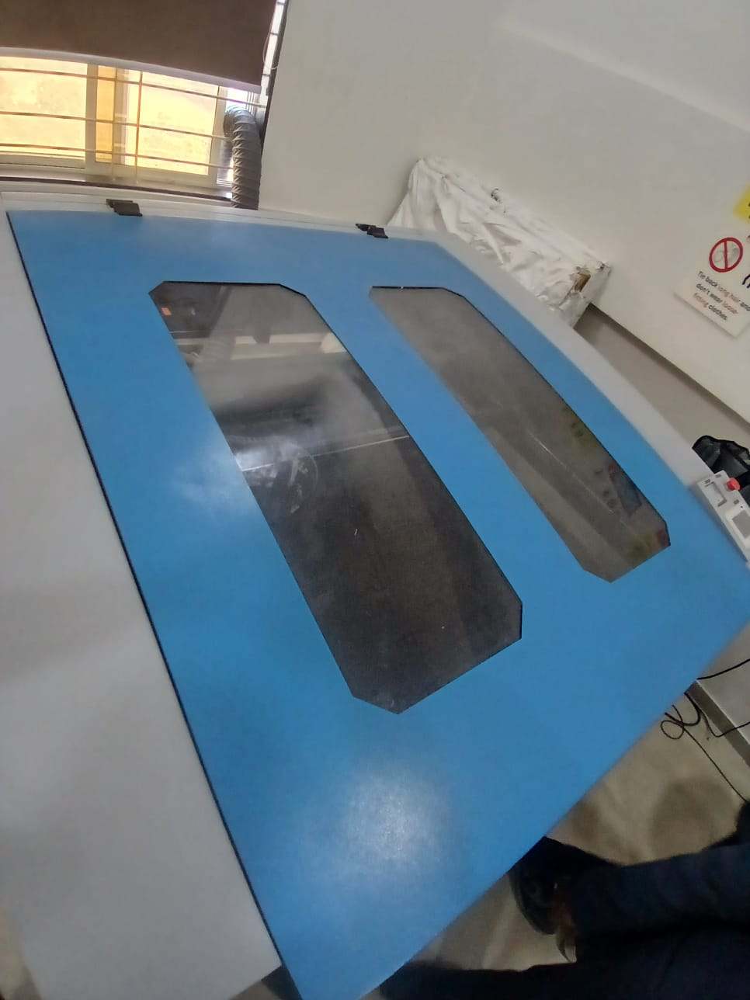
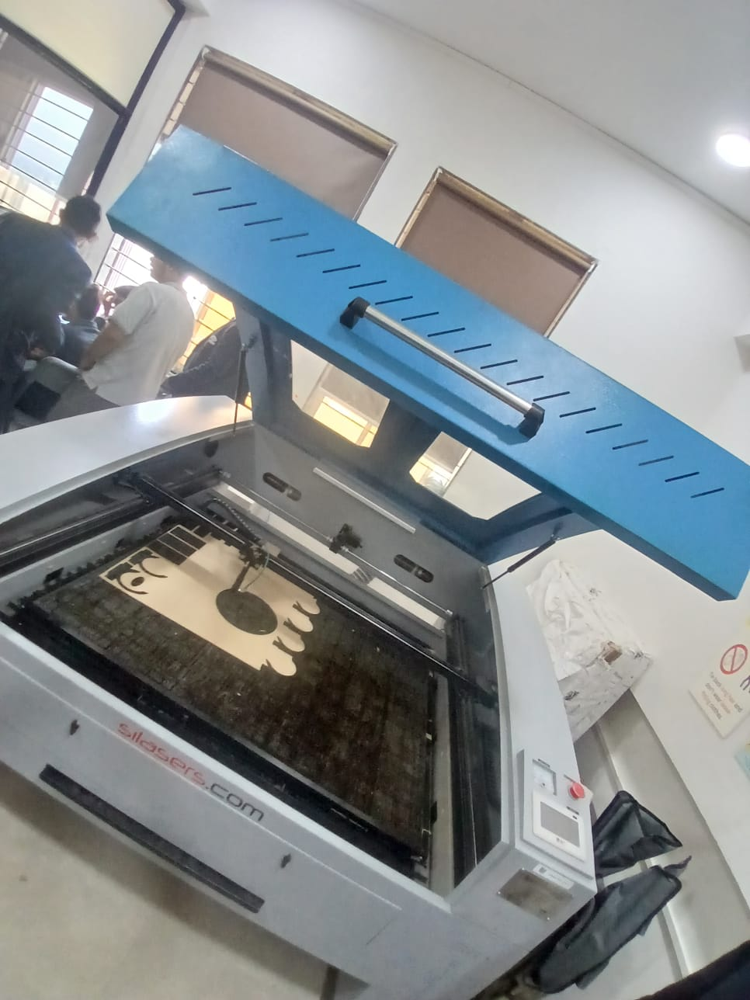

# Laser cutting

Flat sheet parts for the dryer were cut on the Makerspace CO₂ laser cutter.

| Step 1 — Job set-up | Step 2 — Cutting (lid closed) | Step 3 — Finished part |
|---|---|---|
|  |  |  |

## Details

| Item | Value |
|---|---|
| Machine | SIL Lasers CO₂ laser cutting and engraving machine (Suresh Indu Lasers Pvt. Ltd., Pune — "silasers.com" label on the machine) |
| Process | CO₂ laser cutting of non-metal sheet — the focused beam vaporises material along the cut line |
| Machine features | Large flat cutting bed, X–Y gantry with laser head, gas-strut lid with tinted viewing windows, control panel with emergency stop, fume extraction duct |
| Material | Wood-based sheet (plywood / MDF type) |
| Part cut | *to be added* |
| Sheet thickness | *to be added* |
| Laser power / speed / passes | *to be added* |
| Design input | 2D outline (vector, e.g. DXF) exported from the CAD sketch |

## Why laser cutting
- Follows the CAD outline exactly — accurate and repeatable parts.
- Clean, smooth edges; no cutting tool touches the sheet, so no clamping forces or tool wear.
- Fast for flat parts and complex curves (e.g. circular cut-outs).

## Workflow
1. Draw the part outline in CAD and export it as a 2D vector file (DXF).
2. Import the file into the laser software; set cut lines, power, speed and passes for the material.
3. Place the sheet flat on the bed and set the laser focus height.
4. Switch on the fume extraction, close the lid and start the job.
5. Watch the cut through the viewing windows; never leave the machine unattended.
6. Wait for the fumes to clear, open the lid and remove the parts.

## Laser safety
- **Dress smart, stay safe** — tie back long hair, no loose-fitting clothes (Makerspace poster).
- Follow the Makerspace "7 ways to work safe with lasers" rules displayed at the machine.
- Lid closed while the laser fires; view only through the windows.
- Fume extraction on during cutting.
- Never leave the machine unattended; know the emergency stop and fire extinguisher locations.
- Cut only approved materials — never PVC or unknown plastics (toxic gases).

## Reference
- SIL Lasers (Suresh Indu Lasers Pvt. Ltd.), CO₂ laser engraving and cutting machines — https://silasers.com/laser-engraving-and-cutting-machine/
